# Licensed Software Installation Automation

A ServiceNow scoped application that streamlines licensed software installation requests, approval routing, and IT fulfillment.

## Project overview

**Platform:** ServiceNow  
**Application:** Licensed Software Installation Automation  
**Catalog item:** `Licensed Software Installation Request`  
**Flow:** `Licensed Software Installation Approval Flow`

The application provides an employee-facing Service Catalog item and uses a custom Software Inventory table, Flow Designer approvals, a Catalog Task for IT fulfillment, and server-side scripting for manager lookup and license-issue handling.

## Key components

- **Service Catalog:** Request form with nine variables: Requested For, Software, Installation Device, Business Justification, Requested Version, Manager, Required By Date, Urgency, and License Agreement.
- **Software Inventory:** Custom table containing software metadata, owner, license type, total and available licenses, active status, and vendor.
- **Manager lookup:** `LicensedSoftwareManagerAjax` Script Include uses GlideAjax and `GlideRecord` to retrieve a user's manager.
- **Approval workflow:** Manager approval followed by software-owner approval.
- **IT fulfillment:** The successful approval path creates a Catalog Task and waits for its state to become `Closed Complete`.
- **License issue handling:** `Create Incident on License Issue` Business Rule is configured on Requested Item (`sc_req_item`) and includes a duplicate-check pattern.
- **Request tracking:** Requested Item records reflect request approval and workflow outcomes.

## Workflow

1. An employee submits the catalog item.
2. ServiceNow creates a Requested Item.
3. The flow requests manager approval.
4. If approved, the flow looks up the selected Software Inventory record and requests software-owner approval.
5. If both approvals succeed, the flow creates a Catalog Task for IT.
6. The flow waits for the Catalog Task to reach `Closed Complete`.
7. The successful path updates the Requested Item.

The screenshots include completed and waiting flow executions. A waiting execution is expected when the flow is waiting for an approval or for IT fulfillment to finish.

## Screenshots and walkthrough

All screenshots below are the **17 screenshots supplied for this README**. They are stored in the `images/` folder and referenced using relative paths.

### 1. Employee request and catalog configuration

**Catalog request form**

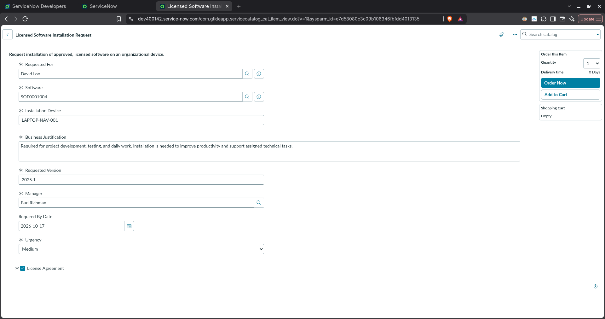

**Catalog item configuration and variables**

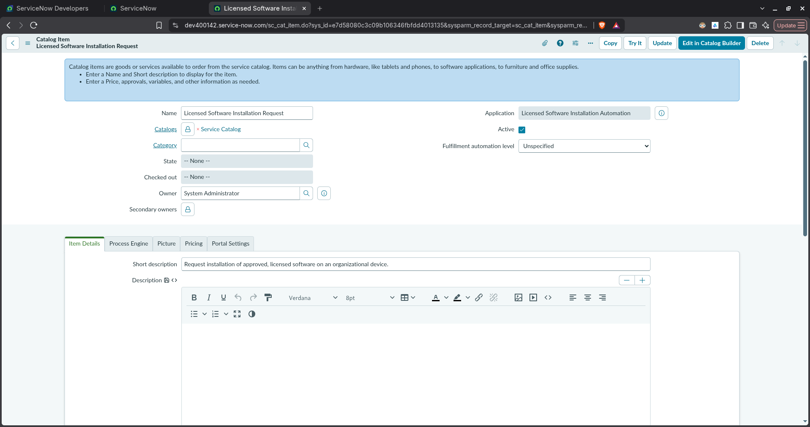

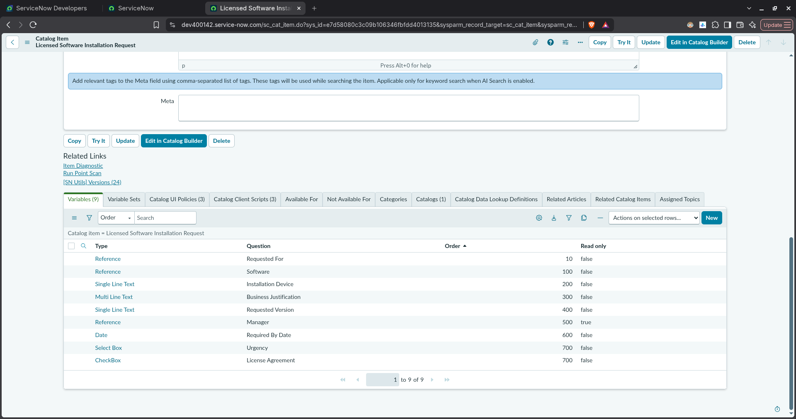

**Order confirmation**

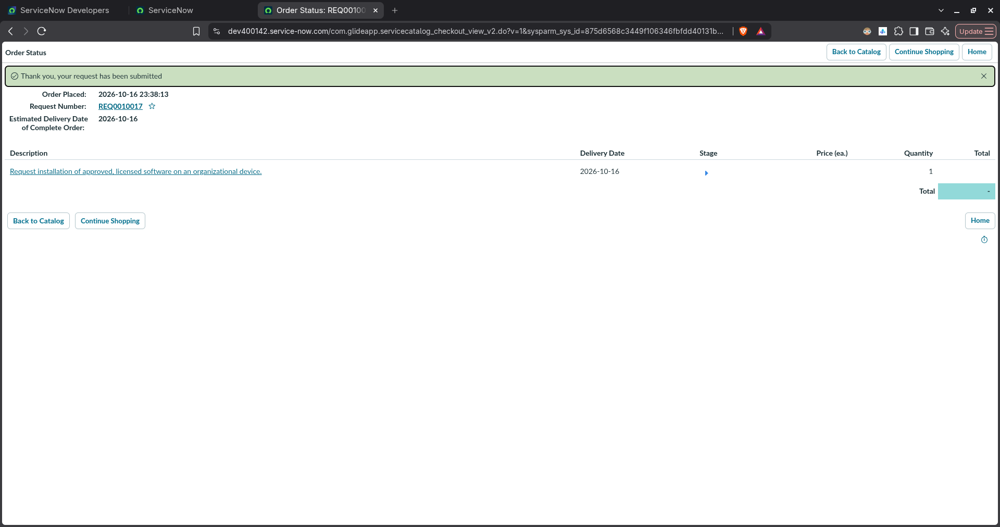

### 2. Flow Designer and execution

**Flow Designer configuration**

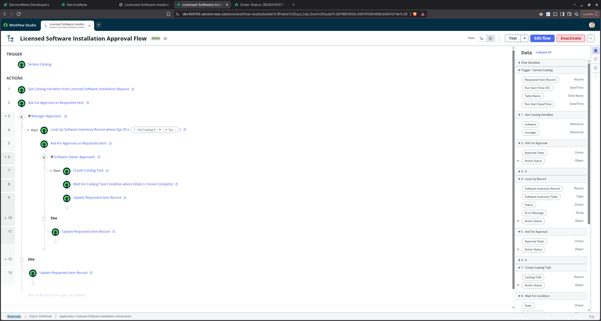

**Waiting for manager approval**

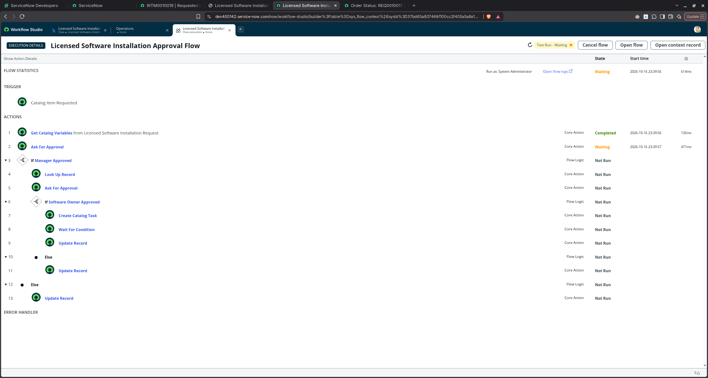

**Waiting for software-owner approval**

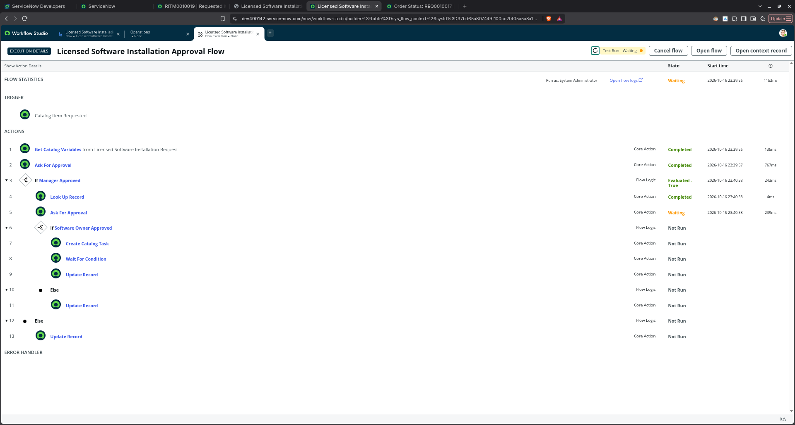

**Waiting for IT task completion**

**Completed flow execution**

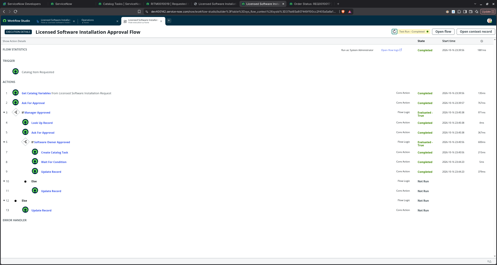

### 3. IT fulfillment and request outcome

**Catalog Task marked Closed Complete**

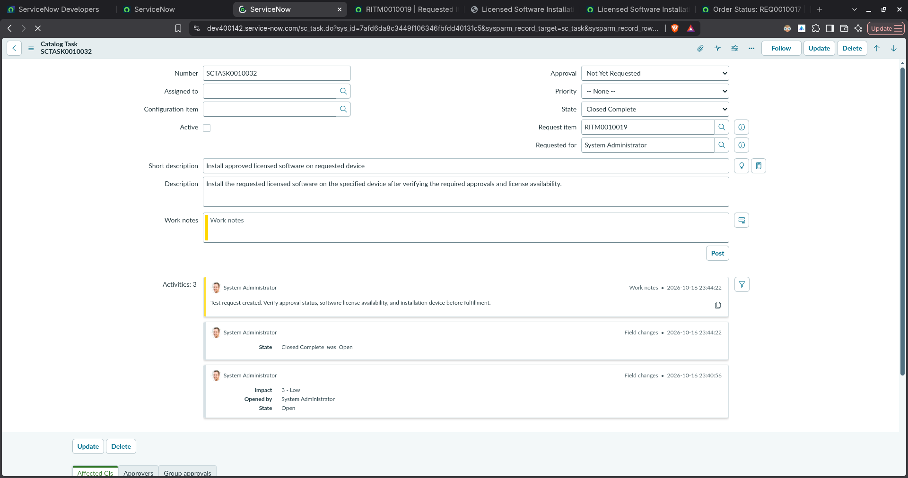

**Requested Item with Approved approval status**

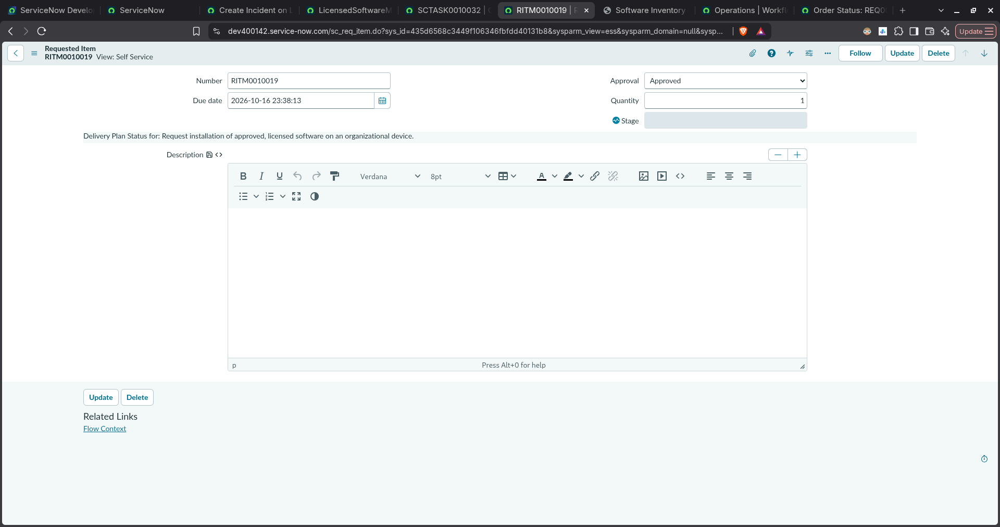

### 4. Application data and scripting

**Scoped application overview**

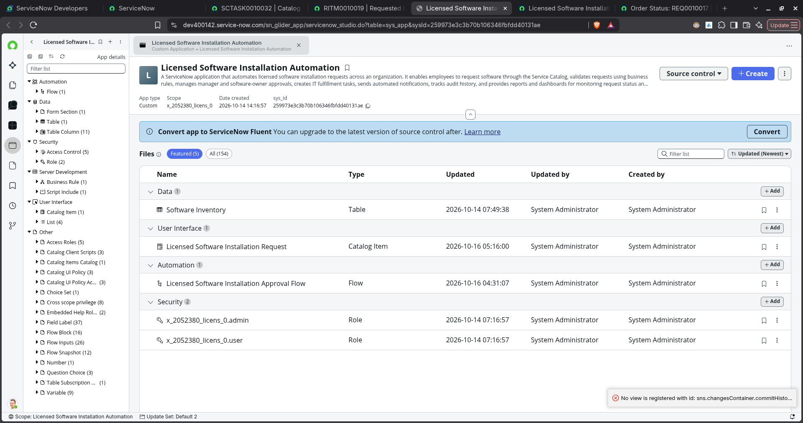

**Software Inventory records**

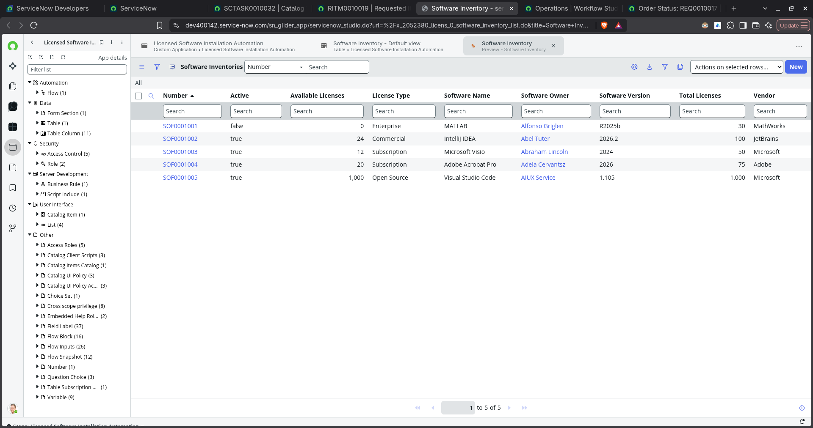

**Software Inventory table fields**

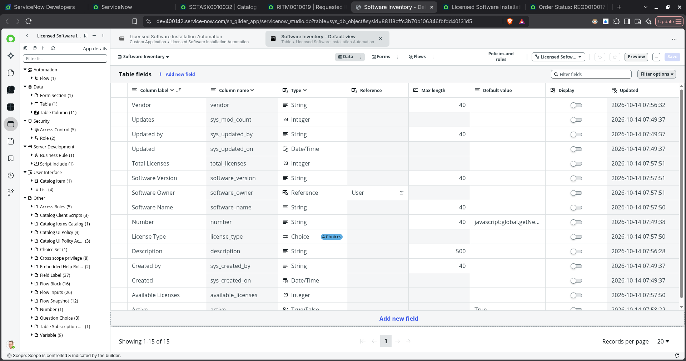

**Manager lookup Script Include**

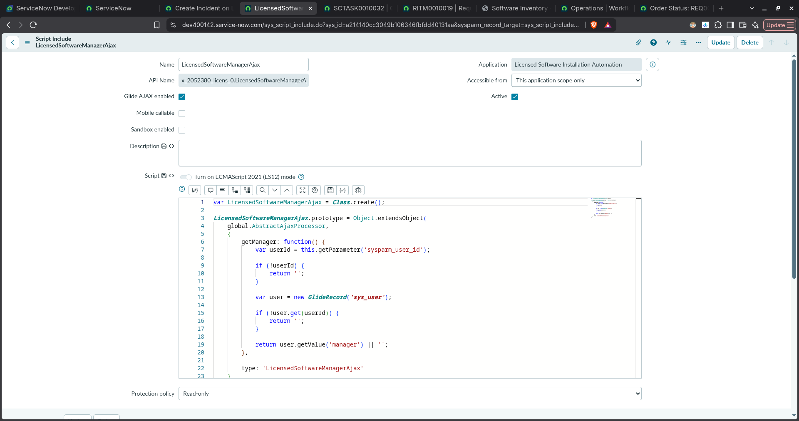

**License issue Business Rule**

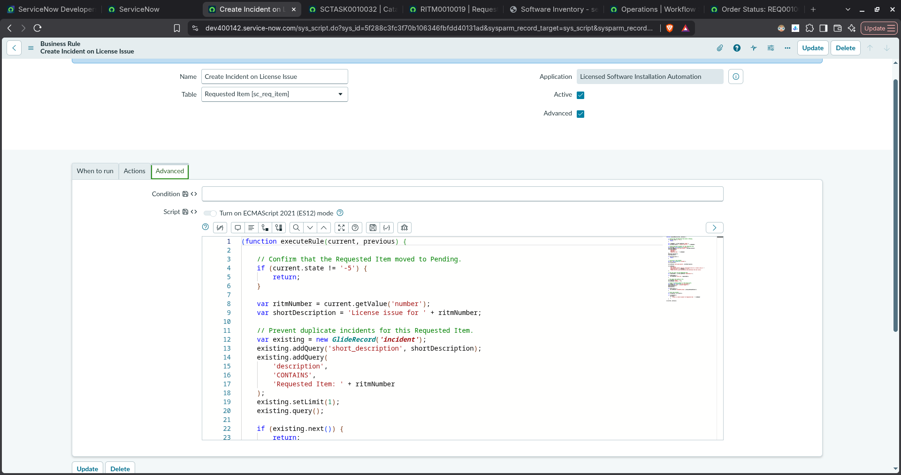

**Related license issue incident**

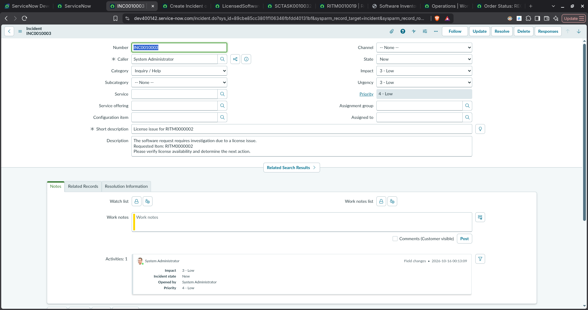

## Validation checklist

Use these checks before presenting the application as production-ready:

- [ ] Submit a request and verify that a Requested Item is created.
- [ ] Verify the manager lookup for different requester records.
- [ ] Test manager approval and rejection.
- [ ] Test software-owner approval and rejection.
- [ ] Verify the inventory lookup uses the selected software record.
- [ ] Verify a Catalog Task is created only after the required approvals.
- [ ] Close the task as `Closed Complete` and verify the Requested Item update.
- [ ] Test missing, inactive, or insufficient-license inventory cases.
- [ ] Verify the Business Rule creates an incident only for qualifying requests and prevents duplicates.
- [ ] Verify roles, record access, notifications, audit history, and reports.

## Notes and limitations

The screenshots document the current development instance and sample records. They do not, by themselves, prove that every rejection path, license-count update, notification, access-control rule, or production scenario has been validated. Confirm those behaviors in the instance before describing them as complete.

Before publishing publicly, redact any personal names or other information you do not want to expose from screenshots.
